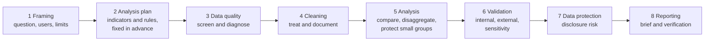

# A survey analysis workflow for humanitarian data

**Worked example: displaced and host households in Sudan, 2024**

A structured workflow for analysing household survey data in humanitarian settings, from framing the question to publishing the results. For each step it sets out the key questions, the expected outputs and common pitfalls, and it is applied in full to a real survey of displaced and host households in Sudan.

**Skills shown:** Survey analysis · Indicator development · Metadata · Disaggregation · Data quality · Data validation · Data protection

## About this project

**The data.** *Sudan: Socio-Economic Impacts of Internal Displacement*, published by the Internal Displacement Monitoring Centre (IDMC) on the [Humanitarian Data Exchange (HDX)](https://data.humdata.org/dataset/socio-economic-impacts-of-internal-displacement-in-sudan) under a CC BY 4.0 licence. The Norwegian Refugee Council (NRC) and local partners interviewed 10,735 households in 2024: 5,968 internally displaced (IDP) and 4,767 host households, in eight states and two rounds (August: Blue Nile, Gedaref, Kassala, Northern, Red Sea, White Nile; November: River Nile, Sennar). Both groups answered parallel questions on livelihoods, food, water, housing, health, safety and education.

**The question.** How do displaced households compare with the host households around them, and do conditions differ between groups of displaced households?

**Why this dataset.**
- It is public household microdata with a full codebook, from a humanitarian crisis.
- Displaced and host households were asked the same questions, which allows the comparison that international guidance on IDP statistics recommends.
- NRC published a report from the same survey, so the results could be checked against an independent source.
- The data have real problems (unclear group definitions, a disability variable that leaves out the respondent, different answer options for the two groups), so the quality steps are tested for real.
- It is close to my own work: household vulnerability assessments for a UN refugee agency.
- It comes from an active conflict, so data protection matters.

> **Note on states.** The dataset covers 8 states in two rounds. NRC's report, *Bursting at the seams*, covers the August round only (6 states), so the validation uses those 6.

## The workflow



A **decision log** runs through every step: what was decided, what else was considered, and why.

| Step | Key question | Output | Template (Excel tab) | Sudan example |
|---|---|---|---|---|
| [1 Framing](workflow/01-framing.md) | What exactly are we asking, for whom, and what can this data not answer? | Analysis plan, part 1: framing | — | [Question, options, users, limits](workflow/01-framing.md#in-the-sudan-example) |
| [2 Analysis plan](workflow/02-analysis-plan.md) | Which indicators, why these, and which rules, before seeing any results? | Analysis plan, part 2: indicators and rules; indicator reference sheets | Analysis plan · Indicator sheet | [7 indicators and rules](workflow/02-analysis-plan.md#in-the-sudan-example) |
| [3 Data quality](workflow/03-data-quality.md) | What is wrong with the data, and what will we do about each problem? | Data quality plan, issue log | Data quality plan | [21 checks and results](workflow/03-data-quality.md#in-the-sudan-example) |
| [4 Cleaning](workflow/04-cleaning.md) | How do we apply the decisions without losing the evidence? | Clean data, cleaning log | Cleaning log | [Changes made](workflow/04-cleaning.md#in-the-sudan-example) · [full log](sudan-example/cleaning-log.csv) |
| [5 Analysis](workflow/05-analysis.md) | How do the groups compare, by how much, and how sure are we? | Tables with confidence intervals and small-cell flags | — | [Results](workflow/05-analysis.md#in-the-sudan-example) · [tables](sudan-example/tables/) |
| [6 Validation](workflow/06-validation.md) | Do the results hold up against other sources and other choices? | Validation table, sensitivity check | Validation | [24 published figures checked](workflow/06-validation.md#in-the-sudan-example) |
| [7 Data protection](workflow/07-data-protection.md) | What can be published without exposing people? | Disclosure check, data protection note | Disclosure checklist | [What is and is not published](workflow/07-data-protection.md#in-the-sudan-example) |
| [8 Reporting](workflow/08-reporting.md) | What does a decision-maker need, and is every number right? | Brief, verification of key figures | Verification | [Brief](sudan-example/brief.pdf) · [checks before release](workflow/08-reporting.md#checks-before-release) |
| Throughout | Why was each choice made? | Decision log | Decision log | [27 decisions](sudan-example/decision-log.md) |

Each step page sets out the method first, then shows the step applied to the Sudan survey. Material too long for a page (the full cleaning log, the results tables, the brief, the decision log) is in [`sudan-example/`](sudan-example/).

All templates are in one workbook: [`templates/survey-analysis-workflow-templates.xlsx`](templates/survey-analysis-workflow-templates.xlsx). The analysis plan tab builds on UNHCR's data analysis plan template.

## Standards behind the workflow

The steps follow the phases of the **Generic Statistical Business Process Model** used in official statistics, and each step draws on published humanitarian and statistical guidance.

| Step | Standards and guidance |
|---|---|
| Overall structure | [GSBPM 5.2, UNECE](https://unece.github.io/GSBPM-5.2/#vi.-descriptions-of-phases-and-sub-processes) |
| 1 Framing | [International Recommendations on IDP Statistics (IRIS)](https://egrisstats.org/recommendations/international-recommendations-on-idp-statistics-iris/) · [IASC Framework on Durable Solutions for IDPs](https://interagencystandingcommittee.org/other/iasc-framework-durable-solutions-internally-displaced-persons) · [Protection Analytical Framework (PAF), Global Protection Cluster](https://www.globalprotectioncluster.org/index.php/field-support/Protection-Analytical-Framework): from broad questions to detailed questions to data needs |
| 2 Analysis plan | [UNHCR Assessment and Monitoring Resource Centre](https://www.unhcr.org/handbooks/assessment/): data analysis plan template |
| 3–4 Data quality and cleaning | [ACAPS, *Data Cleaning* (2016)](https://alnap.org/help-library/resources/technical-brief-data-cleaning/): screening, diagnosis, treatment, documentation · [UNHCR, *Resources for checking and cleaning data for analysis*](https://www.unhcr.org/handbooks/assessment/sites/assessment/files/2023-11/Resources%20for%20checking%20and%20cleaning%20data%20for%20analysis.pdf) |
| 5 Analysis | [OHCHR, *A Human Rights-Based Approach to Data*](https://www.aidsdatahub.org/resource/human-rights-based-approach-data-leaving-no-one-behind-2030-development-agenda) · [Washington Group analytic guidelines](https://www.washingtongroup-disability.com/) · [UN Statistics Division, *Designing Household Survey Samples*](https://unstats.un.org/unsd/demographic/sources/surveys/Handbook23June05.pdf) |
| 7 Data protection | [IASC Operational Guidance on Data Responsibility](https://interagencystandingcommittee.org/operational-response/iasc-operational-guidance-data-responsibility-humanitarian-action) · [OCHA Centre for Humanitarian Data, guidance note series](https://www.unocha.org/publications/report/world/centre-humanitarian-data-guidance-note-series-data-responsibility-humanitarian-action) (incl. statistical disclosure control) |

Where the workflow uses a rule of its own rather than a standard (for example, a minimum of 30 households per figure), the step says so.

## Lessons learnt

What the Sudan survey showed, and why each step of the workflow is there:

1. **Don't trust ready-made variables without checking them.** The dataset had a ready-made variable for "a household member has a disability". When I checked it against the original questions, it counted only the other household members, not the person interviewed. Used as it was, it would have missed almost half of the households with a disability.

2. **Check who is in each group.** Each household is labelled as displaced or not. But 515 households labelled "not displaced" had answered the questions meant for displaced people, and most said where they had fled from. Their label was probably wrong, so I left them out and tested whether this changed the results: one result out of 56 changed.

3. **Check who was asked each question.** Some questions were asked only to people who gave a certain answer earlier. For example, only people who said they felt less safe were asked whether they could move freely. Those answers describe that smaller group, not all households, so I didn't use them to compare groups.

4. **Check that both groups were offered the same answers.** When asked how many meals they eat a day, displaced people could answer "no regular meals", but host households could not. A comparison on this question would not have been fair, so I dropped it.

5. **Compare your results with the published report.** I recalculated 24 figures from the survey's published report and 17 matched within 2 points. The biggest difference: the report says 34% of host households urgently need basic household items, but the data say 84%. Dividing by all households instead of host households gives 32.5%, so the report may have used the wrong total.

6. **Publishing summary tables can be safe even when the full data are not.** On their own, the data look anonymous. But once you add the settlement where people live, about 1 household in 4 becomes almost unique and could be recognised. So I publish results by state only, never the household data.

The findings about Sudan itself are in the [4-page brief](sudan-example/brief.pdf).

## Repository layout

```
workflow/        the method: one page per step, each with the Sudan example
templates/       one Excel workbook with a tab for each output of the workflow
sudan-example/   the evidence: brief, logs, tables, charts, decision log
implementation/  the R code for the Sudan example (secondary)
```

## Implementation

The workflow does not depend on a software package: the steps, rules and templates work the same in R, Stata, SPSS or Excel. For the Sudan example the analysis was run in R; the scripts are in [`implementation/`](implementation/README.md) as one way to carry out steps 3 to 8.

## How this was made

I designed this workflow and took the methodological decisions recorded in the decision log. The results were checked by rerunning all the scripts from a clean copy of the raw data, and against the figures NRC published from the same survey (see [step 6](workflow/06-validation.md)).

## Data and licence

Survey data: IDMC, [*Sudan: Socio-Economic Impacts of Internal Displacement*](https://data.humdata.org/dataset/socio-economic-impacts-of-internal-displacement-in-sudan), HDX, CC BY 4.0. The data are not copied into this repository: download them from HDX (see [`implementation/`](implementation/README.md)). Validation source: NRC (2024), *Bursting at the seams: the impact of war and displacement on Sudan's eastern cities*.
