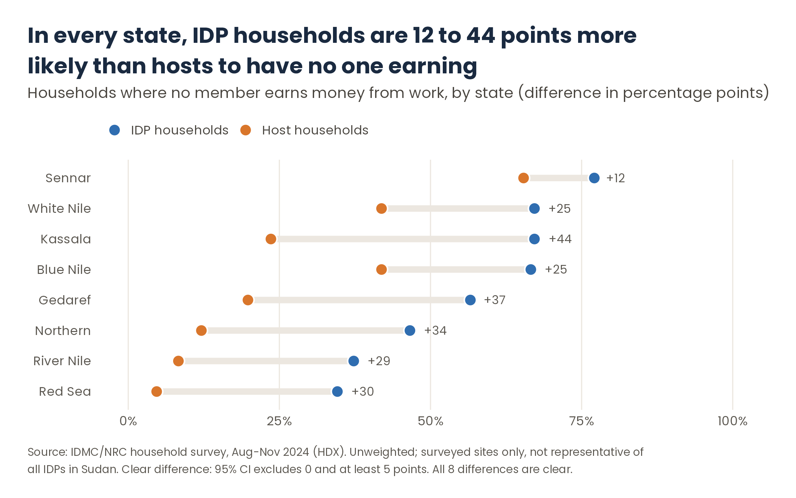

# Step 5. Analysis: compare, disaggregate, protect small groups

**Purpose.** Produce the figures that answer each sub-question, following the rules fixed in [step 2](02-analysis-plan.md), and show how certain each figure is.

**Output.** Results tables, each figure with its number of households (n), a confidence interval and a flag where needed; and one chart per indicator.

**Based on:** [IRIS](https://egrisstats.org/recommendations/international-recommendations-on-idp-statistics-iris/) · [OHCHR, *A Human Rights-Based Approach to Data*](https://www.aidsdatahub.org/resource/human-rights-based-approach-data-leaving-no-one-behind-2030-development-agenda) · [Washington Group analytic guidelines](https://www.washingtongroup-disability.com/) · [UN Statistics Division, *Designing Household Survey Samples*](https://unstats.un.org/unsd/demographic/sources/surveys/Handbook23June05.pdf) · [American Statistical Association statement on p-values](https://www.tandfonline.com/doi/full/10.1080/00031305.2016.1154108)

The analysis follows six principles:

| | Principle | Basis |
|---|---|---|
| 1 | Compare with a reference group in the same place | IRIS |
| 2 | Disaggregate, using standard questions | Human rights-based approach to data; Washington Group; JMP |
| 3 | Respect the sample design | Household survey sampling practice |
| 4 | Judge a difference by its size and its certainty | Statistical practice; the minimum size is the analyst's own rule |
| 5 | Protect small groups | Common practice; the minimum cell size is the analyst's own rule |
| 6 | Look for patterns, and test your choices | Statistical practice |

---

## 1. Compare with a reference group in the same place

- **A figure alone says little.** "60% have no earner" means more when you know it is 25% among their neighbours.
- **Compare like with like:** the same question, the same moment, the same area. For displaced people, IRIS recommends comparing them with non-displaced people in the same place.
- **Report the difference in percentage points,** with its direction: which group is worse off.

## 2. Disaggregate, using standard questions

- **Break results down by the groups in the plan:** sex, disability, age, type of shelter, area. A human rights-based approach asks who is left out, not only how the average is doing.
- **Use standard definitions** so results can be compared with other data: the Washington Group cut-off for disability ("a lot of difficulty" or "cannot do at all"); JMP ladders for water and sanitation; SDG definitions for education.
- **Compare each group with the rest of its population in the same area,** not with a national figure.

## 3. Respect the sample design

- **Without weights or a probability sample, do not pool areas** into one national figure. Report by area.
- **Take account of clustering.** Households interviewed in the same settlement tend to answer alike, so confidence intervals must be calculated by cluster; otherwise they are too narrow.
- **Label the precision honestly.** If the sampling was mixed, call confidence intervals *indicative*.

## 4. Judge a difference by its size and its certainty

- **Two conditions, fixed in advance:** the confidence interval excludes zero (the difference is unlikely to be chance) **and** the difference is large enough to matter (for example, at least 5 points).
- **Avoid the word "significant".** It is read as "important", which a statistical test cannot show.

## 5. Protect small groups

- **Do not report figures based on too few households** (for example, under 30), and flag those just above (30–49). Show n beside every figure.
- **Small cells are both unreliable and a privacy risk:** a figure for a handful of households can point to identifiable people. See [step 7](07-data-protection.md).

## 6. Look for patterns, and test your choices

- **Many comparisons produce some false alarms.** With 56 comparisons, a few will look clear by chance. Base conclusions on patterns ("in 7 of 8 states"), never on one cell.
- **Show "don't know" and "prefer not to answer"** separately when they are frequent; they can change the reading.
- **Run the sensitivity check planned in step 2** and report how many results change. This happens in [step 6](06-validation.md).

---

## Common pitfalls

- **Reporting a national average from an unweighted sample.**
- **Ignoring clustering,** which makes results look more certain than they are.
- **Reporting the largest difference found** instead of the pattern across areas.
- **Showing percentages without n,** so readers cannot tell a figure from 30 households from one from 1,000.
- **Describing a difference as a cause** ("displacement leads to…"). See [step 1](01-framing.md#common-pitfalls).

**Template:** none; the table layouts are fixed in the analysis plan (step 2). One way to run the analysis in R: [`implementation/`](../implementation/README.md).

---

## In the Sudan example

### SQ1. How do IDP and host households compare?

IDP households were clearly worse off than hosts on every indicator in at least 3 of 8 states. Hosts were never clearly worse off on any indicator, in any state.

| Indicator | IDPs clearly worse off | Hosts clearly worse off | No clear difference |
|---|---|---|---|
| No household member earning from work | **8 of 8 states** | 0 | 0 |
| No free access to a health professional | 7 | 0 | 1 |
| Not able to access enough food | 6 | 0 | 2 |
| Urgent need of non-food items | 6 | 0 | 2 |
| Child aged 6–14 attends school | 4 | 0 | 4 |
| No latrine where they live | 4 | 0 | 4 |
| Difficulty accessing safe drinking water | 3 | 0 | 5 |

The widest difference is in work: in every state, IDP households were 12 to 44 points more likely than hosts to have no one earning.

### SQ2. Do conditions differ among IDP households?

No group of IDP households was consistently worse off than other IDPs in the same state, on any of the four indicators. For each group and indicator, clear differences appeared in at most 3 of the states where the group could be reported. Rented accommodation, other shelter types and some disability cells had too few households in several states to judge.

**Reading:** in these data, the main difference is between IDPs and hosts, not within IDPs.

### SQ3. Before leaving home and now (as recalled by IDPs)

| | Before leaving home | Now |
|---|---|---|
| Not able to access enough food | 3–20% of IDP households, by state | 45–88% |
| No household member earning | 6–11% | 35–77% |
| Lost at least one personal document while displaced | — | 55–66% |

These are recalled answers, not measurements at two points in time.

### What was done to respect the design and protect small groups

- Results by state only; no national figures.
- Confidence intervals clustered by settlement, labelled indicative.
- Figures under 30 households not shown; 30–49 flagged.

Full tables: [Sudan results tables](../sudan-example/tables/) (T1 sample, T2 IDP and host, T3 differences among IDPs, T4 recall and lost documents, T5 don't know / prefer not to answer).

**Decisions recorded:** 3, 9, 14–15, 23 and 25 in the [decision log](../sudan-example/decision-log.md).
