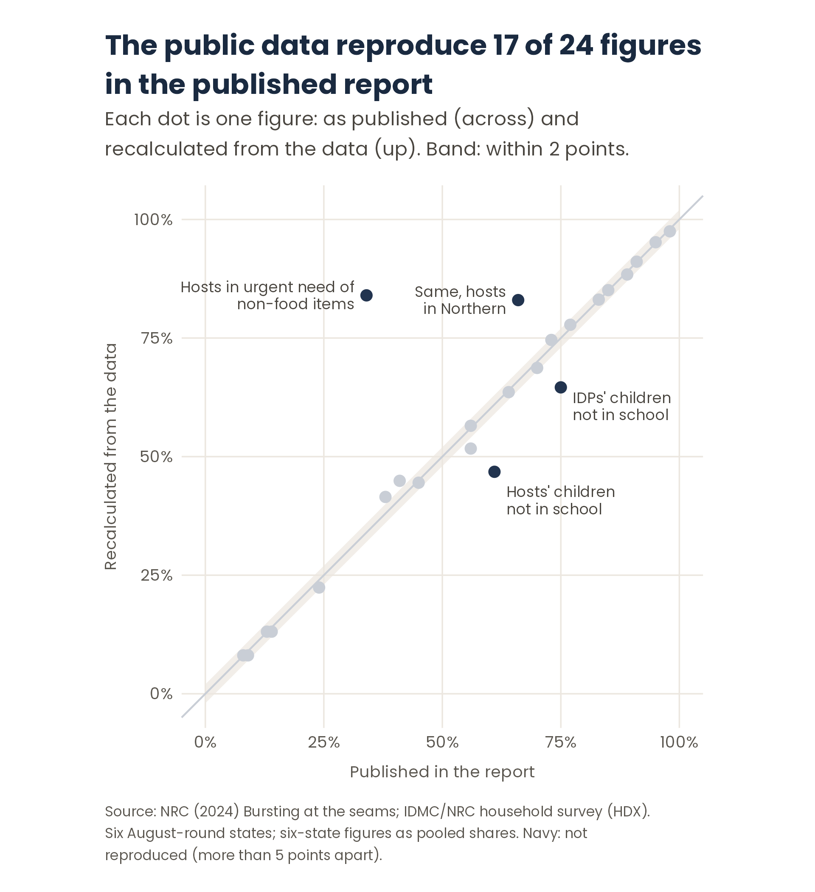

# Step 6. Validation: do the results hold up?

**Purpose.** Test the results against other sources and against your own choices, before anyone relies on them. Validation tests both the data and the analysis.

**Output.** A validation table (each external figure, your figure, the difference, a verdict and an explanation) and a sensitivity check (how many results change under an alternative choice).

**Based on:** [GSBPM 6.2 "Validate outputs"](https://unece.github.io/GSBPM-5.2/#vi.-descriptions-of-phases-and-sub-processes) · [ACAPS, *Data Cleaning* (2016)](https://alnap.org/help-library/resources/technical-brief-data-cleaning/)

Validation works at three levels:

| | Level | It answers |
|---|---|---|
| 1 | Internal | Do the answers agree with each other? |
| 2 | External | Do the results match an independent source? |
| 3 | Sensitivity | Do the results change if a key choice is made differently? |

---

## 1. Internal validation

- **Done in [step 3](03-data-quality.md):** contradictory answers, derived variables against their sources, routing.
- **Repeat it on the results:** do related indicators move together? A state where food access is worst but no one reports difficulty with anything else deserves a second look.

## 2. External validation

- **Find an independent source** with figures that match your indicators: a report published from the same survey, another survey in the same area, administrative data.
- **Fix the comparison before you look:** which figures, how close counts as "reproduced" (for example, within 2 points), "close" (2–5) and "not reproduced" (more than 5).
- **Use one definition for all figures.** If a published figure could be calculated in two ways, report both, and do not pick the closer one for each figure: that flatters the match.
- **Investigate every figure that does not match** with testable hypotheses: a different group definition, a different denominator, a different question. Test each one and report which one, if any, explains the difference. A hypothesis that fits is still a hypothesis, not a proof.

## 3. Sensitivity check

- **Rerun the analysis with the alternative to your most uncertain choice** (named in the analysis plan): a different group definition, a different threshold, a different treatment of missing answers.
- **Report how many results change.** If few change, the conclusions are robust. If many change, say so in the findings.

---

## Common pitfalls

- **Skipping external validation because no source matches exactly.** Even a few comparable figures test the data and the code.
- **Choosing, figure by figure, the definition that matches best.**
- **Explaining away every difference.** Some differences cannot be explained. Say so.
- **Treating a mismatch as your error, or as theirs, before testing.** Either can be wrong.
- **Testing only choices that do not matter.** The sensitivity check should target the choice most likely to change the results.

**Template:** *Validation* tab of the [templates workbook](../templates/survey-analysis-workflow-templates.xlsx). The difference and the verdict are calculated by formula. One way to run this in R: [`implementation/`](../implementation/README.md).

---

## In the Sudan example

### External validation: the published report

The survey's own report, *Bursting at the seams* (NRC, 2024), covers the six August-round states. 24 of its figures match indicators in this analysis; each was recalculated from the public data. Where the report gives a six-state figure, two definitions were calculated: the share of all households pooled, and the average of the six state shares.

| Six-state figures calculated as… | Reproduced (within 2 points) | Close (2–5) | Not reproduced (over 5) |
|---|---|---|---|
| Pooled share of all households | **17** | 3 | 4 |
| Average of the six state shares | **17** | 3 | 4 |

Both definitions give the same count, so the report's method cannot be identified, and the overall result does not depend on the choice. The figures not reproduced under at least one definition (two of them change category with the definition):

| Figure | Published | Pooled | Average of states | Explanation tested |
|---|---|---|---|---|
| Hosts in urgent need of non-food items, six states | 34% | 84% | 83% | Dividing host "yes" answers by **all** respondents, IDPs included, gives 32.5%: consistent with a denominator error in the report (a hypothesis, not proven) |
| Hosts in urgent need of non-food items, Northern | 66% | 83% | (state figure) | No tested explanation reproduces it |
| Host children not attending school, six states | 61% | 47% | 54% | No tested explanation reproduces it, including dropping the age check |
| IDP children not attending school, six states | 75% | 65% (not reproduced) | 71% (close) | Depends on the definition |
| IDPs with difficulty accessing safe water, six states | 41% | 45% (close) | 47% (not reproduced) | Depends on the definition |

Every figure, with its wording, page, both definitions and the tested explanations: [validation table](../sudan-example/tables/T6_validation.csv).

**What the validation showed.** The public data and the analysis reproduce most of the report. The three largest differences are host figures, which fits what step 3 found: the report and the dataset define the groups differently.

### Sensitivity check: the group definition

The main analysis uses the published IDP/host status. Because some respondents answered the other group's questions, the IDP–host comparison was rerun with respondents classified by the questions they answered.

**1 verdict out of 56 changed:** difficulty accessing safe drinking water in White Nile goes from "IDPs clearly worse off" (14.5 points) to "no clear difference" (8.1 points). All other conclusions hold. Full results: [sensitivity table](../sudan-example/tables/S1_sensitivity.csv).

**Decisions recorded:** 6, 16 and 26 in the [decision log](../sudan-example/decision-log.md).
